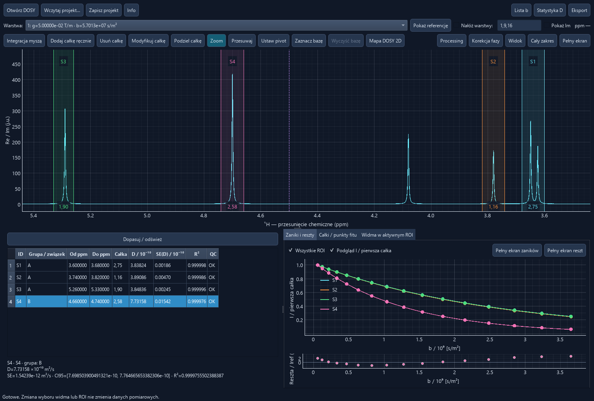

# DOSY Lab 2.1.0

DOSY Lab is a Windows desktop application for classical 1D diffusion NMR acquired on JEOL instruments. It opens raw JDF gradient series, processes the complex FIDs with a shared phase, and estimates the diffusion coefficient **D** from the decay of selected integrals. Version 2.1.0 adds stricter diffusion-metadata checks, more stable monoexponential fitting, scientific quality diagnostics, separate ILT map policies and interactive regularization guidance.

*Synthetic example from an earlier interface revision. The current window has separate tabs for decays and residuals and adds ILT actions to the fit table.*

## Features

- Inspect the reference spectrum at the lowest **b**, switch gradient layers, or overlay several spectra.
- Adjust apodization, zero filling, ppm referencing, digital filter delay, shared phase and per-layer baseline subtraction.
- Draw, edit, split and rescale integrals. Fit a monoexponential decay and inspect individual measured points, fit residuals and quality indicators.
- Compare diffusion coefficients within a named compound group and compare summaries from separate experiments.
- Import and export reusable integration regions with their IDs, groups and ppm bounds.
- Analyze individual decays with **ILT** or solve a joint inverse problem for selected ROIs with **Global ILT**. **Adaptive Local ILT** inverts compatible ROI groups separately.
- Use **Auto λ / stability** to scan regularization, compare residuals and penalties, and track diffusion maxima. Apply suggestions explicitly or keep the manual value.
- Build a 2D $\mathrm{ppm}\times D$ map with linked proton and optional diffusion projections. Inspect native D, display alignment, shared monoexponential fits, Global ILT profiles or Adaptive Local ILT groups.
- Save projects and processing profiles. Export CSV and XLSX tables, JSON metadata, complex data in NPZ and light-background figures.
- Switch the interface between Polish and English using **PL / ENG** next to **Info**.

## Installation on Windows

Use Windows with Python 3.11 or newer. The launcher needs internet access on first installation to download its Python dependencies. Extract the DOSY Lab 2.1.0 source archive, or clone the repository. When the release tag is available from your Git source, check it out to run that exact version.

~~~powershell
git clone https://github.com/Prospero1988/DOSY_lab.git
cd DOSY_lab
~~~

Double-click **DOSY Lab.cmd**, or run it in PowerShell. On first launch it creates `.venv` and installs the required packages. After installation the application runs locally.

~~~powershell
& '.\DOSY Lab.cmd'
~~~

Manual installation in PowerShell

~~~powershell
py -3 -m venv .venv
.\.venv\Scripts\python.exe -m pip install -r bin\requirements.txt
.\.venv\Scripts\python.exe bin\app.py
~~~

If Windows provides `python` instead of `py`, use `python -m venv .venv` for the first command.

## Try a synthetic experiment

~~~powershell
.\.venv\Scripts\python.exe bin\generate_demo.py
& '.\DOSY Lab.cmd' '.\examples\DOSY_demo.jdf'
~~~

The generator creates 16 layers and preserves existing files. Pass a different output path to generate another copy. Use **Add integral manually** and enter `3.60; 3.68`, then repeat with `4.66; 4.74`. The expected **D** values are about $`3.8\times 10^{-10}\ \mathrm{m^2/s}`$ and $`8.0\times 10^{-10}\ \mathrm{m^2/s}`$. The main table displays these as approximately **3.8** and **8.0** in its scaled D column.

## Basic workflow

1. **Open DOSY** and select a raw JEOL JDF. Use **Info** and **b values** to check the acquisition and the diffusion weighting.
2. Reference and phase the spectrum, then apply a baseline correction if needed. Define the integration ranges or import an `.ints` template after referencing.
3. Use **Fit / refresh** for the conventional monoexponential analysis. Inspect the residuals, fit inclusion and line shapes across gradient layers.
4. Use **Analyze ILT** for a single ROI or select two or more rows and choose **Global ILT**. Compare reconstructed decays and inspect **Auto λ / stability** to see how the distributions respond to regularization.
5. Open **2D DOSY map** to inspect signals in $\mathrm{ppm}\times D$. Keep the original view as a reference when comparing model-dependent modes.

| 2D map mode | How D is assigned |
| --- | --- |
| **Original DOSY map** | Uses the independent monoexponential D for each ROI. |
| **D-aligned DOSY · display only** | Places compatible ROI profiles at a representative group D for display. |
| **Global fit DOSY** | Fits a common monoexponential D with independent ROI amplitudes in each accepted group. |
| **Individual ILT · ROI profiles** | Uses completed individual ILT analyses for the current processing. |
| **Global ILT · ROI profiles** | Uses the component intervals of a converged Global ILT analysis. |
| **Adaptive Local ILT** | Groups compatible ROIs from conventional fits and runs a joint inversion for each group. Exploratory view can include independent inversions for ungrouped ROIs. |

ILT map modes offer three policies. **Exploratory** is the default and shows profiles that can be reconstructed from a converged solution, alongside their QC warnings. **QC-filtered** applies conservative assignment checks. **Mono-fit reference** shows the conventional map. The optional 1D overlay preserves visibility of unresolved measured profiles. Exported PNGs identify the policy.

### Quality and regularization

Inspect **QC**, residuals and the **Spectra in active ROI** tab. **OK** is a usable fit with no current flags. **INFO** indicates a diagnostic observation or limited information. **WARNING** identifies a credible model or measurement concern. **INVALID** marks an unusable fit. Shape and phase trends use a noise-aware screen, and baseline warnings compare the fitted D with and without the baseline correction. The tooltip explains the criteria and their effect on D.

The λ scan uses an L-curve heuristic or, with complete independently estimated standard errors for the integrals, the discrepancy principle. Global ILT and grouped AILT select λ conditionally at fixed μ. The scan may return a range without a single suggestion. Persistent maxima can still result from limited diffusion resolution.

## User guide

The [user guide](docs/INSTRUKCJA.md) walks through opening data, processing, phase and baseline correction, integration, fitting, statistics and exports.

- [Keyboard shortcuts](docs/INSTRUKCJA.md#2-navigation-and-processing)
- [Chemical shift reference](docs/INSTRUKCJA.md#chemical-shift-reference)
- [Interactive phase correction](docs/INSTRUKCJA.md#3-phase-correction)
- [Where b values come from](docs/INSTRUKCJA.md#6-b-values)
- [D statistics and fit diagnostics](docs/INSTRUKCJA.md#8-d-statistics)
- [Experimental inverse Laplace analysis](docs/ILT.md)
- [Experimental Global ILT for selected ROIs](docs/GLOBAL-ILT.md)
- [Project files and exports](docs/INSTRUKCJA.md#9-projects-and-exports)
- [2D DOSY maps, alignment and Adaptive Local ILT](docs/DOSY-ALIGNMENT.md)
- [Scientific methods and interpretation](docs/SCIENTIFIC-METHODS.md)
- [Automatic regularization and stability](docs/ILT_REGULARIZATION_2.1.md)
- [Scientific QC and validation](docs/QC_AND_MAPS_2.1.md)
- [Scientific audit archive and reproduction](audit/README.md)
- [2.1.0 release notes](docs/RELEASE-2.1.0.md) and [changelog](CHANGELOG.md)

## Input and scope

- The reader accepts raw JEOL JDF data with complex direct FIDs and gradient layers. Supported 2D storage layouts are `small_two_d` and `two_d`, with 32- or 64-bit values in either byte order. A supported single FID can be viewed as a 1D spectrum.
- Automatic **b** values come from an explicit JDF b axis or verified proton BPP-STE-LED and BPP-DSTE-LED encoding blocks, including the supported presaturation variant. The reader checks the embedded sequence, timing and recorded `st_coef` when available. Conflicting sources require an independently calculated manual b list with provenance.
- The application is designed for classical 1D DOSY. Processed JDFs and 3D COSY-DOSY, COSY-iDOSY and HMQC-DOSY are outside its scope.
- Quantitative results depend on gradient calibration, the b model, integral quality and the suitability of the decay model.

ILT, Global ILT and Adaptive Local ILT are exploratory. Noise, overlap, exchange and b sampling can affect the number, position and width of maxima. Similar D values alone cannot identify a compound. The 2D map uses fitted ROIs and its D-axis display width is adjustable.

## Troubleshooting

- For missing D values, inspect **b values** and count the distinct included b layers. Monoexponential fitting requires at least three and ILT requires at least six per ROI.
- For rippled baselines or signed integrals with unexpected polarity, check the digital filter settings and shared phase before fitting.
- If ILT gives an edge maximum, broaden or reposition the D grid and check the b coverage and reconstruction. If maxima change substantially with regularization, report that sensitivity.
- If the launcher closes, use the manual installation steps above to see the error. See the [troubleshooting table](docs/INSTRUKCJA.md#10-troubleshooting) for project and fit issues.

## Workspace and tests

| Location | Purpose |
| --- | --- |
| `bin` | Application and Python dependencies |
| `tests` | Automated numerical and Qt regression tests |
| `benchmarks` | Version 2.1 scientific validation scripts and results |
| `audit` | Historical 2.0.0 audit, scripts and results |
| `docs` | User guide, screenshots and license |
| `examples` | Reference sucrose and strychnine acquisitions |
| `data` | Default directory for opening local JDF data |
| `projects` | Local `.proj` files |
| `processing` | Local `.list` profiles |
| `integrals` | Local `.ints` files with integral IDs, compound groups and ppm bounds |
| `work` | Local working data |

Git ignores `data`, `work`, `projects`, `processing` and `integrals`.

~~~powershell
.\.venv\Scripts\python.exe tests\run.py
~~~

Tests cover the synthetic example, reference acquisitions when present, numerical processing and the Qt interface in offscreen mode.

## License

DOSY Lab is distributed under the [MIT license](docs/LICENSE). Copyright © 2026 Prospero1988.
