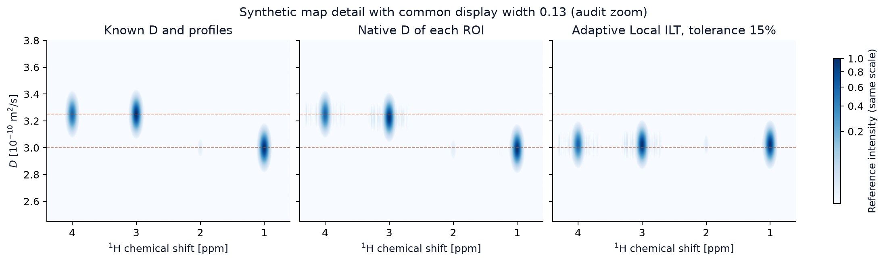
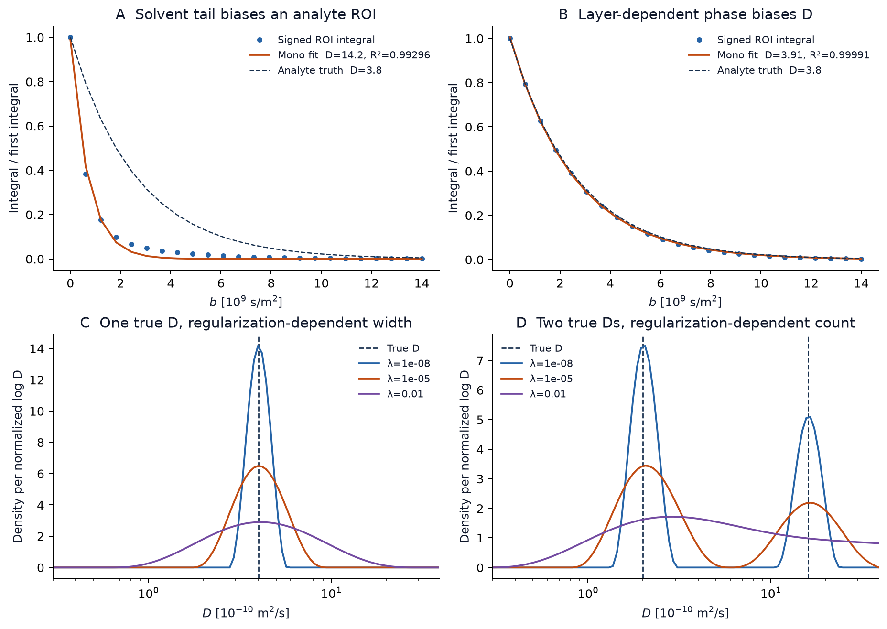

# DOSY Lab 2.0 — niezależny audyt naukowy i numeryczny

**Stan odniesienia** · tag `v2.0.0` · commit `42a775fab309a35e7b5d333846ed94caabfbe85f` · 10 listopada 2026

## 1. Werdykt

**Klasyczny DOSY** jest numerycznie wiarygodny dla dobrze wydzielonego sygnału, gdy nominalne ważenie dyfuzyjne odpowiada rzeczywistemu, faza i baza są stabilne, a zakres $b$ pozwala oszacować zanik. Niezależna całka momentu gradientu odtworzyła nominalne $b$ z trzech JDF. Bezpośrednia DFT i niezależna minimalizacja potwierdziły odpowiednio przetwarzanie i typowe dopasowania. Nie uzyskano niezależnej kalibracji aparatu ani referencyjnych wyników Delta z identycznie zdefiniowanymi ROI.

**Dwa przypadki mogą dać ilościowo błędny wynik bez ostrzeżenia o przyczynie.** Po pierwsze, syntetyczna sprzeczność między zadanym i pochodnym czasem dyfuzji została przyjęta z niezmienionym $b$. Po drugie, ogon rozpuszczalnika w ROI analitu dał $D=14{,}17$ zamiast $3{,}8$, przy $R^2=0{,}993$ i bez ostrzeżenia dopasowania. Oznacza to odpowiednio wadę walidacji metadanych i ograniczenie diagnostyki modelu. Jednostką podawanych poniżej liczb dla $D$ jest $10^{-10}$ m²/s.

**ILT i Global ILT** rozwiązują udokumentowane zadania regularizowane. Poprawność rozwiązania numerycznego nie rozstrzyga liczby ani tożsamości populacji. **Adaptive Local ILT** pozostaje narzędziem eksploracyjnym. Przy tolerancji 15% scalił na mapie dwa rozróżnialne w konwencjonalnych fitach zestawy sygnałów o prawdziwych $D=3{,}00$ i $3{,}25$. To wynik założeń grupowania, a nie uzyskana rozdzielczość dyfuzyjna.

## 2. Zakres, środowisko i pochodzenie danych

- Gałąź `audit/scientific-validation-v2.0` została utworzona od tagu wydania. Skrypty i wyniki są poza `bin/`. Aplikacja, przykładowe JDF, tag i gałąź `main` pozostały w swoich wersjach. Raport i poprawki proponowane poniżej dotyczą wyłącznie audytu.
- Windows 11 x86-64, kompilacja 26300, Python 3.12.0, NumPy 2.5.4, SciPy 1.18.1, OpenBLAS 0.3.34.106.0 raportowany przez NumPy, PySide6 6.12.0, pyqtgraph 0.14.0 i openpyxl 3.1.5. Obliczenia uruchomiono z `OPENBLAS_NUM_THREADS=1`. Wykresy wykonano w Matplotlib 3.11.2 zainstalowanym osobno.
- Ziarno główne `20261110`, strumienie pochodne `+1…+5` oraz `+100+i`. Niezależne generatory używają `default_rng` z zadanym ziarnem. Przypadki bez szumu są deterministyczne.
- Dane rzeczywiste to trzy surowe serie DOSY z `examples/` i jedno widmo protonowe jako kontrola importu. Nazwy, pełne SHA-256, parametry i wartości $b$ zapisano w [benchmarku JSON](results/benchmark.json). Wszystkie trzy serie mają 16 warstw. Sacharoza STE i DSTE po 9567 punktów FID, strychnina STE 35874. Widmo protonowe ma jedną warstwę i poprawnie pozostaje bez listy $b$.
- Dokumentacja sprzętowa to lokalny *JNM-ECZ/ECZL Liquid Application User’s Manual*, NMECZ-USA-6, §2.1–2.2 i §2.4.2a–c, strony PDF 34–36 i 43–52, oraz *Pulse Sequence Commentary Manual*, NMECZ-SEQ-4, §1.5.1 i §8.1, strony PDF 19 i 779–780. Do konkretnego timingu użyto programów osadzonych w JDF. Tabele starszego manuala opisują również wcześniejsze nazwy i warianty. Nie utożsamiano ich automatycznie z aktualnymi przebiegami z JDF.
- Zestaw aplikacji przeszedł **86/86** testów, w tym 50 testów poza klasą GUI i 36 testów Qt offscreen w trzech partiach. GUI uruchamiano z wcześniej zaimportowanym openpyxl. Wnioski naukowe pochodzą z niezależnych eksperymentów poniżej.

## 3. Fizyka i nominalne ważenie dyfuzyjne

Dla swobodnej dyfuzji wzdłuż osi gradientu i wybranej drogi koherencji użyto efektywnego przebiegu $g_\mathrm{eff}(t)=p(t)g_z(t)$. Moment to $q(t)=\gamma\int_0^t g_\mathrm{eff}(s)\,ds$, a $b=\int q(t)^2dt$. Dla translacji ze stałą prędkością $v$, przy domknięciu $q$ na końcu, faza od prędkości jest proporcjonalna do $-v\int q(t)\,dt$. Dla klasycznej pary prostokątnej PGSE o odstępie początków $\Delta$ wynika $b=(\gamma g\delta)^2(\Delta-\delta/3)$. W BPP-STE i BPP-DSTE osobno całkowano każdą połówkę, wszystkie odstępy i czasy magazynowania. [Stejskal i Tanner](https://doi.org/10.1063/1.1695690) · [Jerschow i Müller](https://doi.org/10.1006/jmre.1997.1123)

| Kontrola | Interpretacja |
| --- | --- |
| $\gamma_{\mathrm H}$ | Kod używa $267\,522\,187{,}44$ rad/(s·T), zgodnie z CODATA 2018. Niezależne obliczenie stosuje $2\pi$ razy $42{,}577478518$ MHz/T. Aktualizacja CODATA 2022 zmienia wynik $b$ o rząd $10^{-9}$ względnie. [NIST 2018](https://pml.nist.gov/cuu/pdf/all_2018.pdf) · [NIST 2022](https://physics.nist.gov/cgi-bin/cuu/Value?gammapbar%7Csearch_for=ratio) |
| $g$, $\delta$, $\Delta$ | Przykładowe $g$ zapisano nominalnie w T/m. Import rozpoznaje też mT/m i µT/m w kontekście programu oraz wykładniki osi w nagłówku. W modelach $\delta$ jest łączną długością dwóch podstawowych lobów, każdy trwa $\delta/2$. $\Delta$ jest deklarowanym `diffusion_time`, a w DSTE oba okresy magazynowania wynikają z połowy $\Delta$ i odpowiednich opóźnień. |
| Wymiary | $\gamma g\delta$ ma wymiar m⁻¹, współczynnik czasowy ma wymiar s. Stąd $b$ ma wymiar s/m², a $bD$ jest bezwymiarowe. Pomylenie Hz/T z rad/(s·T) dałoby błąd czynnika $(2\pi)^2$. |
| Droga koherencji | Efektywne znaki STE to `++ \| --`, DSTE `++ \| ---- \| ++`. Puls 180° odwraca znak koherencji tam, gdzie odwrócona jest fizyczna polaryzacja gradientu. W przerwach magazynowania $p=0$, więc spoiler w tym przedziale nie zmienia $q$. W obu modelach $q$ wraca do zera. W STE sacharozy $\int q\,dt/(\gamma g)=1{,}8\times10^{-4}$ s², w DSTE wartość wynosi około $-1{,}4\times10^{-21}$ s² w tej kwadraturze. |
| Wariant z presaturacją | Matcher dopuszcza alternatywne umieszczenie spoilera wewnątrz tego samego okresu magazynowania. Dla założonej drogi i czasu nie zmienia to całki $b$. Brak rzeczywistego wzorca tego wariantu w tagu. Oddziaływania IRR, skuteczności tłumienia i wpływu na amplitudę nie walidowano. |

Niezależny generator przebiegu zakłada pięć funkcji. Prostokąt, półsinus, kwadrat półsinusa, trapez z liniowymi narastaniami po 10% czasu oraz wygładzony prostokąt z narastaniami półkosinusowymi po 10%. Każdy lob ma 20 001 węzłów. Pole znormalizowane pod lobem podniesione do kwadratu wynosi kolejno $1$, $4/\pi^2$, $1/4$, $0{,}81$, $0{,}81$. W dziesięciu kombinacjach kształt × sekwencja różnica od współczynnika aplikacji nie przekroczyła $4{,}2\times10^{-9}$ względnie. Kształty odtworzono jako modele nominalne zgodne ze współczynnikami. Nie uzyskano pomiaru przebiegu prądu lub pola ani niezależnego zrzutu tabeli FG dla każdego kształtu. Tylko `S_RECTANGLE` występuje w dostarczonych rzeczywistych seriach.

| JDF | $\Delta$ / $\delta$ / opóźnienia [ms] | Zakres $g$ [T/m] | Zakres $b$ [10⁹ s/m²] | Współczynnik zapisany [s] | Zmiana po uwzględnieniu przerw RF |
| --- | --- | ---: | ---: | ---: | ---: |
| Sacharoza STE | 100 / 2 / 2 | 0,05–0,40 | 0,05701–3,64886 | 0,0796630811 | −0,00441% |
| Sacharoza DSTE | 100 / 2 / 1 + 1 | 0,05–0,40 | 0,05664–3,62472 | 0,0791361622 | −0,01333% |
| Strychnina STE | 80 / 2 / 2 | 0,05–0,20 | 0,04542–0,72671 | 0,0634630811 | −0,00554% |

Zgodność każdego nominalnego $b$ z niezależną kwadraturą bez przerw RF była lepsza niż $3{,}3\times10^{-12}$ względnie. Kolumna RF pokazuje wynik **modelu czasowego** z długościami 90° = 4,34 µs i przełączeniem w środku impulsu, bez symulacji propagatora RF. Przy krótszym $\Delta$ lub dłuższym impulsie tę aproksymację trzeba ocenić ponownie. Matcher rozpoznaje osadzony tekst programu. Nie obserwuje faz wykonanych przez spektrometr, odpowiedzi gradientu, jego nieliniowości przestrzennej ani resztkowych prądów wirowych. Jawna oś $b$ z JDF ma pierwszeństwo nad modelem i w tej ścieżce nie jest porównywana z obliczonym $b$. Dane nie zawierały osobnego przykładu takiej osi. [Kod importu i modeli](https://github.com/Prospero1988/DOSY_lab/blob/v2.0.0/bin/jeol.py#L114)

## 4. Processing, dopasowanie i niepewność

Na syntetycznych przyczynowych FID, dla pięciu binów FFT o obu znakach, bezpośrednia suma DFT zgadza się do $9{,}6\times10^{-12}$ w jednostkach FFT. Oś ppm zgadza się dokładnie w tych binach. Dodatnia częstotliwość względem nośnej zwiększa ppm, a odwrócenie osi w GUI jest konwencją prezentacji. Wspólne apodyzacja wykładnicza i gaussowska, zerowanie 1/2/4/8, faza PH0 i PH1 względem wspólnego pivotu oraz przesunięcie referencji o 0,11 ppm zachowały względny zanik jednego sygnału do $1{,}5\times10^{-15}$. Wspólne operacje są liniowe. Różnica amplitudy bezwzględnej po zerowaniu wyniosła około 0,0004%, zgodnie z innym próbkowaniem brzegów całki. Zmiana składu lub fazy sygnału między warstwami narusza warunek proporcjonalności.

Korekcja filtra 19,6875 próbki odczytana dla tych JDF jest modelem rampy fazowej z metadanych. Nie sprawdzono pełnej odpowiedzi cyfrowej ani osi ppm względem referencji laboratoryjnej. Obcięcie pasma jest maską wspólną. Rozpoznawanie już obciętego pliku korzysta z flag i czasów akwizycji. Integracja interpoluje końce i stosuje trapezy do podpisanej części rzeczywistej. Sygnał ujemny nie jest zastępowany modułem. Wszystkie 24 ujemne całki odwróconego analitu zostały prawidłowo odrzucone. W pojedynczych warstwach ujemne punkty są utrzymywane i sygnalizowane. [Odczyt filtra](https://github.com/Prospero1988/DOSY_lab/blob/v2.0.0/bin/jeol.py#L196) · [Processing i całkowanie](https://github.com/Prospero1988/DOSY_lab/blob/v2.0.0/bin/core.py#L85)

| Przypadek FID, prawdziwy analit $D=3{,}8$ | $D$ z fitu | $R^2$ | Interpretacja |
| --- | ---: | ---: | --- |
| Czysty i ze wspólną fazą 25° | 3,800 | 1,000000 | Skala całki może się zmienić, względny zanik jest zachowany. |
| Faza narasta między warstwami od 0° do 55° | 3,910 | 0,999908 | +2,90%. Nominalne CI 3,883–3,937 pomija prawdziwe $D$. |
| Narastający offset bez korekcji | 0,934 | 0,655052 | Mocny błąd z widocznym ostrzeżeniem. |
| Ten sam offset i czysta maska bazy | 3,800 | 1,000000 | Osobna baza dla każdej warstwy odtwarza zanik. |
| Maska bazy na ogonie rozpuszczalnika | blisko zera | −0,0170 | Baza usuwa zmienną część ogona i zmienia krzywą. Ostrzeżenia aktywne. |
| Dwie nierozdzielone linie w ROI | 4,701 | 0,993156 | +23,7% wobec analitu, bez ostrzeżenia fitu. |
| Rozpuszczalnik poza ROI, duży ogon dyspersyjny | 14,173 | 0,992956 | +273,0%, nominalne CI 13,063–15,282, bez ostrzeżenia fitu. |
| Bardzo słaby sygnał i szum FID | 0,891 | 0,015230 | Dziewięć punktów ujemnych i jawne ostrzeżenia. |

Oszacowanie wariancji całki zależy od korelacji po apodyzacji i zerowaniu oraz od regresji bazy. Program nie wyprowadza takiej macierzy kowariancji z FID. Opcjonalne $\sigma(I_i)$ są dostarczane przez użytkownika, a fit przyjmuje niezależność błędów. Użycie RMS reszt jako zastępczego S/N w AILT jest testem operacyjnym. Reszty zawierają też niedopasowanie modelu i nie są niezależnym pomiarem szumu. [Edycja niepewności](https://github.com/Prospero1988/DOSY_lab/blob/v2.0.0/bin/ui.py#L738) · [Kryterium AILT](https://github.com/Prospero1988/DOSY_lab/blob/v2.0.0/bin/adaptive_ilt.py#L40) · [Eksperymentalne ograniczenia S/N](https://mr.copernicus.org/articles/2/733/2021/)

**Niezależna referencja mono.** Dla każdej kandydackiej wartości $D$ wyeliminowano liniowo dodatnią amplitudę w $\min b$, używając $\exp[-(b-\min b)D]$. Zastosowano 180 punktów startowych w logarytmie, skalarne domknięcie minimów i porównanie z $D=0$. Przy zwykłych zakresach i w dopasowaniach modelu błędnego największa różnica wyniku aplikacji od referencji wyniosła $4{,}1\times10^{-5}$ w jednostce tabeli. Oba solvery mogą poprawnie oszacować ten sam **pozorny** parametr przy złym modelu. Referencja wykrywa odrębną porażkę przy samych późnych warstwach. Dla dokładnych danych z $b=100–180\times10^9$ s/m² i $D=0{,}4$ aplikacja zwróciła startowe $D=5$, $R^2=-1{,}187$, podczas gdy referencja odzyskała 0,400. Oznaczono słabą jakość, lecz wynik formalnie jest `ok=True`. Próby z NaN, Inf, zerowymi intensywnościami i tylko dwiema różnymi wartościami $b$ zostały prawidłowo odrzucone. Płaski dodatni zanik został zwrócony jako minimalnie dodatni wynik z CI wykluczającym zero, mimo $D=0$. [Kod dopasowania](https://github.com/Prospero1988/DOSY_lab/blob/v2.0.0/bin/core.py#L191)

**Monte Carlo.** Po 160 realizacji dla każdego z trzech poziomów szumu, 24 punkty $b$, znane $D=4$, $\sigma_i$ narastające od 0,45 do 1,40 nominalnego poziomu. Przy nominalnym szumie 7,5% dopasowanie z podaną prawidłową $\sigma_i$ miało obciążenie −0,24%, empiryczne SD 0,249 i medianę SE 0,246. Odrzucanie obserwacji o zmierzonym $I\le2\sigma_i$ zmieniło obciążenie na −2,71%, empiryczne SD 0,280. Przy szumie 2,5% bias ważonego fitu zmienił się z −0,05% na −0,43%. To **test decyzji analityka o masce**, aplikacja sama tak nie odrzuca punktów. Empiryczne pokrycie ważonego przedziału bez odrzucania wyniosło 94,4–96,3% w tej próbie. Przy złej fazie, rozpuszczalniku i błędzie skali $b$ modelowe CI mogą być bardzo wąskie i błędne.

**Odtwarzalność plików.** Ponowne wczytanie projektów wygenerowanych dla trzech JDF odtworzyło całki dokładnie. ID, grupa i granice z `.ints` wróciły bez zmian. Macierze FID, ppm, $b$, widmo zespolone i fazowane w NPZ są identyczne z macierzami w pamięci. Eksport zweryfikowano w katalogu tymczasowym. Domyślny processing z jawnymi testowymi ROI dał dla sacharozy STE $D=4{,}062$, $3{,}629$, $3{,}718$, a DSTE $3{,}991$, $3{,}907$, $3{,}837$, wszystkie z $R^2>0{,}9986$. Różnice między ROI przewyższają niektóre lokalne SE. Granice są jawne w JSON i służą do testu odtwarzalności. Rozrzut nie dowodzi, że jedna konkretna sekwencja jest błędna. Analogicznie surowe wartości dla dwóch ROI strychniny są wynikami dopasowania, bez przypisania i niezależnej walidacji wzorca.

## 5. ILT i Global ILT

### Indywidualny ILT

Na siatce środków komórek w liniowym lub logarytmicznym $D$ sprawdzono znak i skalę wykładnika $K_{ij}=\exp(-b_iD_j)$. Masa $f_j$ jest nieujemna, a wykres prezentuje znormalizowaną gęstość w bezwymiarowej współrzędnej siatki. W powiększonej macierzy test referencyjny używa BVLS, z samodzielnym generowaniem siatki, wag i macierzy kar. Badano oba rzędy kary i oba typy siatki przy 50 komórkach z szumem heteroscedastycznym. Różnica predykcji od NNLS ≤ $2{,}8\times10^{-15}$ w jednostkach sygnału. Odchylenie KKT ≤ $3{,}6\times10^{-16}$. Wyniki potwierdzają zarówno mnożnik $P$ przy karze zerowego rzędu, jak i czynnik $(0{,}05P)^2$ stosowany do drugich różnic przed podniesieniem normy do kwadratu. Zmiana typu siatki zmienia miarę i funkcjonał kary. Sama gęstość w $\log D$ i $D$ nie ma tych samych jednostek i nie nadaje się do porównania po wysokości. [Kod ILT](https://github.com/Prospero1988/DOSY_lab/blob/v2.0.0/bin/ilt.py#L47) · [Day, inwersja i regularyzacja](https://pubmed.ncbi.nlm.nih.gov/21683632/)

- Jednorodny sygnał $D=4$ bez szumu daje środkowe 90% masy ILT w przybliżeniu 3,15–4,84 przy $\lambda=10^{-8}$, 2,45–6,28 przy $10^{-5}$ i 1,41–11,63 przy $10^{-2}$. To efekt regularyzacji i geometrii jądra.
- Dla mieszaniny 2 i 16 logarytmiczna siatka 100 komórek daje 2,054 i 16,457 przy $\lambda=10^{-5}$. Zmiana na siatkę liniową z tymi samymi krańcami i $\lambda$ daje 2,834 i 22,709. Na liniowej siatce 400 komórek nadal otrzymano 2,685 i 22,659. Zawężenie zakresu 100 liniowych komórek z 0,25–40 do 1–25 przesunęło maksima do 1,120 i 18,160. Gęstsza siatka nie usuwa zależności od kary i granic.
- Dla $D=4$ i 4,5 obserwuje się jedno maksimum mimo dokładnych danych w badanych ustawieniach. W przypadku trzech składowych 1, 5 i 20 dwa maksima znikają przy przejściu z $\lambda=10^{-8}$ do $10^{-2}$. Mały RMS nie ustala liczby populacji.
- W zestawie szumowym z 49 punktami logarytmicznymi i mieszaniną 90:10 oba maksima były dopasowane w 6/6 realizacji bez szumu i w 1/6 przy SD 0,005 i $\lambda=10^{-8}$. Przy $\lambda=10^{-5}$ i tym szumie 0/6. W odpowiadających sześciu realizacjach jednoskładnikowych nie było dodatkowych maksimów. Oddzielny przypadek samego szumu daje maksimum 18,2, z RMS 0,424 w skali znormalizowanej. Dodatni sygnał w pojedynczych punktach wystarcza do przejścia wstępnej walidacji.
- Dla modelu dwóch stanów 60:40, $D_1=2$, $D_2=16$, $\Delta=0{,}1$ s i idealnych wąskich impulsów, użyto wykładnika macierzowego generatora wymiany i tłumienia. Bez wymiany odzyskano 2,05 i 16,46. Przy sumie szybkości wymiany 10 s⁻¹ maksima wyniosły 2,16 i 12,77. Przy 1000 s⁻¹ został pik 7,69, blisko średniej 7,6. Wygenerowany ciągły rozkład logarytmiczny dał pojedyncze maksimum około 3,97 przy małej karze. Pojedyncze maksimum może zatem opisywać szybkie uśrednianie albo rzeczywisty ciągły rozkład. [Model wymiany i zakres jego stosowalności](https://doi.org/10.1016/j.jmr.2024.107760)

### Global ILT

Każdy ROI jest kolumną. Jądro $N_b\times P$ działa na masy $P\times M$. Rozwiązano model nieujemny z resztami ważonymi, karą $\lambda P$ razy kwadrat normy Frobeniusa oraz karą $\mu\sqrt M$ razy sumę norm wierszy. Wagi w każdej kolumnie są normalizowane do jednostkowej normy. Taka normalizacja celowo wyrównuje wpływ całkowity ROI na zadanie. Dobre wartości $\sigma_i$ zmieniają wpływ punktów w obrębie ROI, ale stałe $\sigma_i$ danej kolumny skracają się niezależnie od bezwzględnego S/N. Dla identycznych powielonych kolumn zarówno strata, jak i kara rosną liniowo z liczbą ROI dzięki $\sqrt M$. Test 2, 4 i 8 powtórzeń dał identyczne maksima i reszty na kolumnę. Przemnożenie jednej kolumny przez 1000 pozostawiło masy bez zmian w teście rozłącznym i poprawnie zmieniło jednostki rekonstrukcji. [Przygotowanie danych](https://github.com/Prospero1988/DOSY_lab/blob/v2.0.0/bin/global_ilt.py#L52) · [Solver](https://github.com/Prospero1988/DOSY_lab/blob/v2.0.0/bin/global_ilt.py#L107) · [Beck i Teboulle](https://doi.org/10.1137/080716542)

Niezależnie obliczono wartość celu, naruszenia KKT i dolne ograniczenie z dualności Fenchela. Dla reszty ważonej $r$ zastosowano dualną próbę $v=2r$ i sprzężenie kary wierszowej z ridge, z dodatnią częścią argumentu. Różnica celu od raportu aplikacji ≤ $4{,}5\times10^{-16}$. W problemie rozłącznym $\mu=0$ maksymalna różnica rekonstrukcji względem BVLS wyniosła $3{,}56\times10^{-4}$ w skali wejściowej przy domyślnej tolerancji Global ILT. Dla $\lambda=10^{-8}$ z częściowym udziałem i domyślną tolerancją otrzymano konserwatywne luki dualne rzędu $1{,}4–1{,}8\times10^{-4}$ przy komunikacie o zbieżności. Luźne dolne ograniczenie nie dowodzi błędu optimum tej wielkości. Po wymuszeniu 20 iteracji solver prawidłowo ustawił brak zbieżności, a miara stacjonarności wyniosła 0,00471. Zbieżność zależy od kryterium stacjonarności, a nie od stabilności maksimum.

- Wspólny $D=4$, stosunek amplitud 1:1000, jednakowy bezwzględny SD 0,0015. Global ILT zwrócił 3,974, 8,508 i 38,998, znormalizowany RMS słabego ROI 0,371. To dwa nadmiarowe maksima i ostrzeżenie o granicy. Przy 1:100 znalazł pojedyncze 4,18. W tym szczególnym teście osobny ROI będący wyłącznie szumem uzyskał zerową masę, co pokazuje, że fałszywe składowe nie występują zawsze.
- Częściowo współdzielone $D=2,16$, trzy ROI, szum i maska. Przy $\lambda=10^{-6}$ i $\mu=10^{-4}$ wynik 1,953, 10,422 i 38,998. $\mu=0$ daje 1,953, 9,907 i 38,998. Problem nie wynika wyłącznie z grupowej kary. Przy $\mu=0,1$ widać 1,237 i 7,306 oraz dużo większy RMS, a przy $\mu=10$ rozwiązanie jest zerowe. W obu ostatnich wypadkach solver zbiega numerycznie.
- Dla dwóch czystych ROI o $D=4$ i 4,35 agregat pokazuje jedno maksimum 4,18 zarówno dla $\mu=0$, jak i $\mu=10^{-4}$. Wspólny pik agregatu może powstać z dwóch rozkładów, które nakładają się po regularyzacji, nawet gdy w zadaniu nie ma sprzężenia.

## 6. Adaptive Local ILT i zgodność mapy z sygnałem

Grupowanie weryfikuje skrajne $D$ względem progu $200|D_1-D_2|/(D_1+D_2)$ w procentach. Nie stosuje łączenia przez łańcuch. Brak SE nie wyklucza ROI, a dostępne SE powyżej 25% $D$ wyklucza go na etapie selekcji konwencjonalnej. Grupę weryfikuje dopasowanie wspólnego $D$ z osobnymi amplitudami. Próg pogorszenia RMS to większa z wartości `1,5 × RMS niezależny` i `RMS niezależny + 0,005`. Nie jest to statystyczny test równości dyfuzji. Następnie lokalny ILT rozwiązuje problem z własną siatką. Wagę słabego ROI, po normalizacji, ogranicza do zakresu 0,25–1 na podstawie oszacowania S/N. [Selekcja i wspólny fit](https://github.com/Prospero1988/DOSY_lab/blob/v2.0.0/bin/dosy_alignment.py#L22) · [Local ILT](https://github.com/Prospero1988/DOSY_lab/blob/v2.0.0/bin/adaptive_ilt.py#L32)

- Przy tolerancji 5%, balansie 10 i $\lambda=10^{-6}$ syntetyczne pary 3,00 i 3,25 otrzymały lokalne 3,082 i 3,143. Pierwotna różnica 0,25 została zmniejszona do 0,061. Konwencjonalne fity, od 2,988 do 3,250, trafniej rozdzielały cztery wybrane ROI. Podniesienie tolerancji do 15% dało wszystkim czterem ROI jedno 3,023. Dopasowanie wspólnej monoeksponenty w tej grupie dało 3,116, a tryb D-aligned 3,006. Te trzy liczby odpowiadają trzem różnym operacjom. Tylko druga jest estymacją wspólnego parametru monoeksponenty. Przy 8% algorytm połączył R1, R2 i R3, pozostawiając R4 poza grupą.
- Przy tolerancji 5% zmiana balansu z 10 na 1000 przesunęła pierwszą grupę z 3,082 do 2,902. Przy tolerancji 15% podniesienie $\lambda$ do $10^{-4}$ odrzuciło profile R1 i R5, pozostawiając ich oryginalne reprezentacje. Grupowanie, waga i kara mogą zmieniać wnioski niezależnie od formalnej zbieżności. R7 z prawdziwymi $D=3,9$ pozostał nierozstrzygnięty. W mapie awaryjnej uzyskuje pozycję pozorną 4,524. R8, ROI samego szumu, pozostał nierozstrzygnięty, ale ma dodatni fit z $R^2=0,00788$. Filtr oryginalnej mapy może zachować taki fit, ponieważ sprawdza dodatni $D$ i formalne `ok`, a nie jakość.
- Oracle mapy z dwoma idealnie znanymi składowymi 3 i 12 oraz udziałem słabszej 2,91% zwrócił **cały** profil referencyjny w $D=3$. Słabsza linia w ppm pozostała, ale otrzymała niewłaściwe $D$. Przypadek izoluje regułę 5% i ścieżkę jednoskładnikową od błędu solvera. Dla nakładających się granic dwa ROI miały 12 wspólnych dodatnich próbek, wszystkie wyzerowano na mapie. Maskowanie jest celowe. Nie świadczy o nieobecności sygnału w tych ppm.
- Dla wielu zaakceptowanych składowych dopasowanie NNLS na binach ppm używa stałych baz zaniku z przedziałów ILT. Dla kontrolnego oracle z udziałem 35,5% słabszej składowej odtworzono oba nałożone profile przy znanych bazach. Maksymalny błąd intensywności wyniósł $4{,}5\times10^{-16}$. W trybie adaptacyjnym suma profili może zostać przeskalowana do dodatniej referencji. To konserwuje intensywność tam, gdzie podział przejdzie bramki, lecz nie dowodzi jednoznaczności podziału. Ścieżka jednej składowej kopiuje podpisaną referencję. Przykład R2 zachowuje podpisane widmo i ma pole 0,849 pola dodatniej referencji w macierzy profilu. Widoczna dodatnia część pozostaje taka sama po odcięciu wartości ujemnych. Nie należy interpretować tej różnicy jako utraty w renderze. [Bramki profili](https://github.com/Prospero1988/DOSY_lab/blob/v2.0.0/bin/dosy_alignment.py#L102) · [Render mapy](https://github.com/Prospero1988/DOSY_lab/blob/v2.0.0/bin/dosy_map.py#L446)

Oś $D$ używa jednostki $10^{-10}$ m²/s, rośnie do góry. Tryb Original i D-aligned zachowują próbki ppm oraz kształt niezamaskowanych fragmentów. W trybach rozdzielających zmienia się rekonstrukcja amplitud. Wspólna skala barw, próg podłogi względem najsilniejszego sygnału, wzmocnienie i szerokość Gaussa są ustawieniami prezentacji. Przy maksimum $D=19$ domyślna FWHM wynosi 0,57, a nastawy pozwalają na 0,038–2,85. Dodatni pik o wysokości 0,1% maksimum może zniknąć przy podłodze 1%. Nie są to kontury estymowanej gęstości prawdopodobieństwa ani ilościowe zakresy niepewności. Projekcja sumuje dodatnie próbki ppm przed zastosowaniem podłogi. Zmiana ustawień wyświetlania nie poprawia rozdzielczości pomiaru. [Maska wspólnej części ROI](https://github.com/Prospero1988/DOSY_lab/blob/v2.0.0/bin/dosy_map.py#L44) · [Próg i saturacja](https://github.com/Prospero1988/DOSY_lab/blob/v2.0.0/bin/dosy_map.py#L512)

## 7. Zestaw benchmarków i stabilność

Podstawowa siatka ma 49 warstw, w tym $b=0$ i 48 wartości logarytmicznych od $0{,}02$ do $35\times10^9$ s/m². To szeroki plan służący do testów rozdzielczości. Rzeczywiste JDF w repo mają węższe zakresy. W benchmarku dyskretnym maksimum uznano za zgodne, gdy $|\log(D_\mathrm{est}/D_\mathrm{true})|\le0{,}10$, z przypisaniem jeden do jednego. `extra` oznacza maksimum bez zgodnego odpowiednika, więc obejmuje także maksimum przesunięte zbyt daleko, a nie wyłącznie nową populację. Przypadki ciągłe i wymiana o skończonej szybkości nie mają arbitralnej prawdy liczby pików.

| Przypadki | Dane i zakres oceny | Miejsce w JSON |
| --- | --- | --- |
| A–D | Jeden, dwa odległe, dwa bliskie oraz trzy współczynniki bez szumu | `cases`, `individual` |
| E–F | Stosunki 1:1–1:1000, szum o stałej i zmiennej wariancji, maska i wagi | `cases`, `monte_carlo`, `joint` |
| G–I | Zmienna faza, offset, skażona baza, późne lub skupione gradienty i nakładanie linii | `processing`, `cases` |
| J–K | Wspólne i częściowo współdzielone składowe, stosunek amplitud i liczba ROI | `joint`, `adaptive_maps` |
| L–M | Dwa stany z wymianą i bez, oraz ciągły logarytmiczny rozkład $D$ | `cases` |
| N–P | Sam szum, bardzo słaby analit, ogon rozpuszczalnika i ujemne całki | `cases`, `processing`, `joint` |

Systematyczne siatki obejmują 50/100/200/400 komórek, dwa zakresy, siatki liniową i logarytmiczną, trzy $\lambda$ oraz plan 12/24/49 punktów liniowych, logarytmicznych lub o krótkiej rozpiętości. Próby szumu mają 12 realizacji na ustawienie, sześć dla jednego i sześć dla dwóch składników. Global ILT badano dla trzech poziomów $\lambda$, pięciu $\mu$, współdzielonych i częściowych ROI, masek oraz 2/4/8 powtórzeń. AILT badano dla sześciu tolerancji 1–30%, czterech balansów 1–1000 i dwóch $\lambda$. JSON zawiera pozycje, liczby składowych, błędy dopasowania, zbieżność, KKT, wyniki resamplingu i odtwarzalności. Konkretnych granic rozdzielczości dla sprzętu nie wyznaczano.

## 8. Rejestr ryzyk i rekomendacje

Klasy odnoszą się do skutku dla użytkownika, z uwzględnieniem istniejących ostrzeżeń. Mutacje metadanych, sztuczne FID i oracle mapy są kontrolowanymi kontrprzykładami. Nie świadczą o wystąpieniu usterki w konkretnym niezmodyfikowanym JDF.

| ID i klasa | Lokalizacja oraz mechanizm | Zaobserwowano, oczekiwano | Zalecana korekta po audycie |
| --- | --- | --- | --- |
| **B1 · CRITICAL** | [jeol.py, matcher i factory_b](https://github.com/Prospero1988/DOSY_lab/blob/v2.0.0/bin/jeol.py#L114). Matcher wymaga `delta_large = diffusion_time` w programie, ale sprawdza czas i `st_coef` wyłącznie względem zapisanej wartości pochodnej. | W kopii parametrów podwojenie `diffusion_time` przy starym `delta_large` oraz `st_coef` nie zmieniło zaakceptowanego $b$. Gdyby rzeczywisty timing odpowiadał podwojonej wartości, skala $D$ byłaby 2,017× za duża. Oczekiwano odmowy lub jawnego konfliktu. | Sprawdzać równość parametrów źródłowych i pochodnych w SI, wykonalność pełnego timingu i zgodność jawnej osi, gdy dostępne są oba źródła. Zapisać rozbieżność w QC, bez naprawiania listy przez odgadywanie. |
| **B2 · HIGH, warunek pomiaru** | [jeol.py](https://github.com/Prospero1988/DOSY_lab/blob/v2.0.0/bin/jeol.py#L185). Nominalne $g$ z pliku nie zawiera gwarancji zgodności z polem w próbce. | Symulowane $g_\mathrm{true}=1{,}15g_\mathrm{nom}$ daje 5,290 zamiast 4,000 z $R^2=1$. Oczekiwano jawnego odróżnienia wyniku nominalnego w miejscach, gdzie użytkownik odczytuje $D$. Informacja już istnieje w metadanych. | Propagować status i pochodzenie kalibracji do tabel, wykresów oraz eksportu. Pole błędu kalibracji traktować jako wspólną niepewność systematyczną, oddzielną od SE poszczególnych fitów. |
| **P1 · CRITICAL, identyfikacja** | [core.py, całka i fit](https://github.com/Prospero1988/DOSY_lab/blob/v2.0.0/bin/core.py#L182), [d_statistics.py, QC](https://github.com/Prospero1988/DOSY_lab/blob/v2.0.0/bin/d_statistics.py#L28). Jedna całka może sumować kilka sygnałów lub ogon poza ROI. Ocena opiera się na cechach fitu i nie bada zmienności profilu. | Ogon rozpuszczalnika dał 14,173 zamiast 3,8 bez ostrzeżenia. Nierozdzielona mieszanina dała 4,701 zamiast 3,8. Oczekiwano wyniku jawnie pozornego lub ostrzeżenia przy zmianie kształtu między warstwami. Algorytm dopasował dostarczone całki zgodnie z modelem. | Dodać niedestrukcyjny test proporcjonalności zespolonych profili z uwzględnieniem szumu i opcjonalnym badaniem stabilności względem ROI i maski bazy. Wyświetlać reszty i ostrzeżenie obok wyniku. Zachować surowe całki. |
| **P2 · HIGH** | [core.py, wspólna faza i baza](https://github.com/Prospero1988/DOSY_lab/blob/v2.0.0/bin/core.py#L67). Wspólna faza chroni zanik, gdy warstwy są zgodne. Przesunięcie fazy zależne od gradientu i dopasowanie bazy do ogona zmieniają proporcje całki. | Faza zmienna dała 3,910, bez ostrzeżenia i z CI poza prawdziwym 3,8. Skażona maska bazy dała wartość blisko zera z ostrzeżeniami. Oczekiwano wykrycia niezgodnej fazy i kontroli wrażliwości na wybór maski. | Raportować amplitudę dyspersyjną i zmiany fazowe między warstwami. Dodać podgląd stabilności po zmianie maski. Automatyczne niezależne fazowanie mogłoby samo zmieniać zanik i wymagałoby osobnego audytu. |
| **M1 · HIGH** | [core.py, stały start i absolutne b](https://github.com/Prospero1988/DOSY_lab/blob/v2.0.0/bin/core.py#L204). Przy późnym zakresie $b$ model i jego gradient przy starcie praktycznie znikają. | Dokładne dane $D=0,4$ i późne $b$ dają wartość startową 5, a niezależny fit 0,400. Ostrzeżenie istnieje, ale wynik zachowuje status `ok=True`. Oczekiwano zbieżności do minimum lub odmowy. | Parametryzować amplitudę przy $\min b$, użyć niezależnego wyszukania startu lub profilowania po $D$, sprawdzić skalowany gradient i brak poprawy reszt. Ekstrapolację do $b=0$ raportować osobno i sprawdzać zakres numeryczny. |
| **M2 · MEDIUM** | [core.py, CI](https://github.com/Prospero1988/DOSY_lab/blob/v2.0.0/bin/core.py#L213). Warunek `D>0` nie rozpoznaje bliskości granicy. Lokalna kowariancja ignoruje ograniczenie oraz wspólny błąd. | Stały sygnał o $D=0$ daje małe dodatnie $D$ i CI wykluczające zero, przy ostrzeżeniu o jakości. W Monte Carlo odrzucanie na podstawie zmierzonego S/N zmieniło obciążenie. Oczekiwano jawnej informacji o braku identyfikowalnego zaniku. | Wprowadzić diagnozę płaskiego zaniku i profilowane lub jednostronne granice w pobliżu zera. Opisać mechanizm selekcji punktów i warunkowość CI. Nie zamieniać dodatnich i ujemnych obserwacji na moduł. |
| **I1 · HIGH, interpretacja** | [ilt.py, regularyzacja i detekcja](https://github.com/Prospero1988/DOSY_lab/blob/v2.0.0/bin/ilt.py#L71). Układ ma małą efektywną rangę. Szerokość, maksimum i próg 5% odnoszą się do konkretnej siatki oraz kary. | Dwa maksima zmieniają się w jedno po zmianie $\lambda$. Sama zmiana typu siatki przesunęła prawdziwą szybką składową 16 do 22,709. Czysty szum dał pik 18,2. Oczekiwano informacji o braku stabilności, a nie automatycznego przypisania komponentu. | Raportować zakres wrażliwości, oznaczać brzegi i niestabilne maksima. Kalibrować regułę diagnostyczną na ślepych próbach, a nie na jednym pozytywnym przykładzie. |
| **G1 · HIGH** | [global_ilt.py, normalizacja kolumn](https://github.com/Prospero1988/DOSY_lab/blob/v2.0.0/bin/global_ilt.py#L52). Szum o stałym SD może dostać ten sam względny udział w funkcji celu co czysty sygnał. | W 1:1000 pojawiły się dwa nadmiarowe maksima mimo zbieżności. Dla $\mu=0$ zbliżone maksima już się nakładają, a przy dużej karze wynik może być zerowy. Oczekiwano wyraźnego rozróżnienia jakości ROI i statusu solvera od interpretacji pików. | Dodać jawne poziomy zaufania między ROI, oparte na niezależnym szumie i replikatach. Umożliwić sprawdzenie wariantu z i bez danego ROI. Wyświetlać stabilność względem $\lambda,\mu$, znormalizowane RMS i stan zerowej masy. |
| **G2 · MEDIUM** | [global_ilt.py, stacjonarność](https://github.com/Prospero1988/DOSY_lab/blob/v2.0.0/bin/global_ilt.py#L133). Stop używa względnego odwzorowania proksymalnego. Przy małym ridge niewielka stacjonarność nie wyznacza ścisłej granicy odległości mas. | Cel zgodny z obliczeniem niezależnym. Dla małego $\lambda$ luka dualna jest zauważalna względem celu. Limit 20 iteracji jest prawidłowo sygnalizowany. Oczekiwano osobnego kryterium dokładności obok flagi zbieżności. | Udostępnić lukę primal–dual lub kontrolę niezależnej tolerancji oraz status stabilności pików. Nie obniżać tolerancji w ciemno bez pomiaru kosztu i korzyści. |
| **A1 · HIGH** | [dosy_alignment.py, grupowanie](https://github.com/Prospero1988/DOSY_lab/blob/v2.0.0/bin/dosy_alignment.py#L31), [adaptive_ilt.py](https://github.com/Prospero1988/DOSY_lab/blob/v2.0.0/bin/adaptive_ilt.py#L127). Tolerancja i bramka RMS ograniczają zgodność, ale nie stanowią testu wspólnej dyfuzji. | Dwie prawdziwe grupy 3 i 3,25 stały się linią 3,023. Zmiana balansu zmienia pozycję o ok. 0,180 w opisanej grupie. Oczekiwano wskazania, które różnice zostały zastąpione przez wspólne założenie. | Pokazywać zakres i niepewności natywnych $D$, odchylenia na ROI i stabilność przypisania, utrzymać mapę natywną jako punkt odniesienia. Nie opisywać wyrównanej linii jako potwierdzenia wspólnego związku. |
| **A2 · HIGH** | [dosy_alignment.py, ilt_profiles](https://github.com/Prospero1988/DOSY_lab/blob/v2.0.0/bin/dosy_alignment.py#L102). Wkład poniżej 5% na referencji odpada, a ścieżka jednej składowej kopiuje całe ROI. | Oracle 3 i 12 z udziałem 2,91% rysuje oba piki w ppm przy $D=3$ bez odrzucenia profilu. Oczekiwano oznaczenia odrzuconej masy, pozostawienia ROI jako nierozdzielonego lub pokazywania reszty bez przypisania. | Nie przypisywać niewyjaśnionego profilu do dominującego $D$. Rejestrować odrzuconą masę, status i przyczynę per ROI. Zastosować sprawdzenie zgodności widmowej także dla ścieżki jednej składowej. |
| **V1 · MEDIUM** | [dosy_map.py, kryterium i maska](https://github.com/Prospero1988/DOSY_lab/blob/v2.0.0/bin/dosy_map.py#L38), [eksport i render](https://github.com/Prospero1988/DOSY_lab/blob/v2.0.0/bin/dosy_map.py#L446). Dodatnie `D` może trafić na mapę mimo QC z ostrzeżeniem. Dodatkowo nakładanie ROI i podłoga ukrywają dane. | Szumowy R8 z $R^2=0,00788$ spełnia filtr formalnego fitu, a próbki wspólne znikają w teście 12/12. Oczekiwano jasnego rozróżnienia widoczności, odrzuconych binów i wiarygodności fitu. | Powiązać flagi QC z warstwą i eksportem, opcjonalnie wykluczać wyniki ryzykowne. Pokazać maski i udział pominiętej referencji. Zachować osobne opisy jednostek projekcji oraz ustawień FWHM, progu i wzmocnienia. |
| **D1 · LOW** | [Dokumentacja mapy](https://github.com/Prospero1988/DOSY_lab/blob/v2.0.0/docs/DOSY-ALIGNMENT.md#ilt-component-profiles) i [metody](https://github.com/Prospero1988/DOSY_lab/blob/v2.0.0/docs/SCIENTIFIC-METHODS.md). Opis bramki 5% i przypisania pojedynczego profilu pozwala zrozumieć implementację, ale nie sygnalizuje wprost możliwości błędnego przeniesienia słabszej linii. | Instrukcja deklaruje eksploracyjność metod. Brak wyraźnego przykładu, gdzie dobrze wyglądający komponent na mapie ma błędne $D$ przez uproszczenie profilu. Oczekiwano informacji widocznej przy wynikach i eksporcie. | Udokumentować oracle A2 i ograniczenia automatycznego grupowania. Precyzyjnie odróżnić wiarygodność wzoru nominalnego od walidacji sondy. |

## 9. Dokumentacja a implementacja

- README poprawnie ogranicza import do surowego 1D DOSY JEOL i nazywa ILT metodą eksploracyjną. Sformułowanie „verified” przy modelach $b$ oznacza w aktualnym kodzie rozpoznanie tekstu i zgodność nominalnego współczynnika. Nie oznacza kalibracji gradientu ani walidacji wszystkich wariantów na spektrometrze.
- Równania i jednostki w [Scientific Methods](https://github.com/Prospero1988/DOSY_lab/blob/v2.0.0/docs/SCIENTIFIC-METHODS.md) zgadzają się z kodem w sprawdzonych przypadkach. Oznaczenie $W$ jest mnożnikiem reszty. Dane z kodu `w2` zawierają jego kwadrat, a dodatkowa waga ROI w AILT mnoży ważony **kwadrat** reszty. Gęstości ILT są liczone w znormalizowanej współrzędnej liniowej lub logarytmicznej, zgodnie z opisem.
- Manual opisuje podpisane całki i zachowanie wyłączonych punktów. Dołączyć zastrzeżenie, że wspólna faza nie koryguje względnych różnic faz między warstwami i że zgodność z Deltą zależy od użycia tych samych intensywności, okien, maski, osi i kalibracji. Nie porównywano do metod Multi ani NUG Delty.
- Release notes i [opis trybów mapy](https://github.com/Prospero1988/DOSY_lab/blob/v2.0.0/docs/DOSY-ALIGNMENT.md) odróżniają pozycjonowanie profili, wspólny fit i rekonstrukcję. Warto wyeksponować, że Global ILT liczy się na całkach i dopiero odrębna procedura odtwarza niektóre profile w ppm. Dostępność pięciu trybów nie ustanawia ich równoważności ilościowej.
- Zgodność z CONTIN i SPLMOD nie była celem implementacji i nie została stwierdzona.

## 10. Odtworzenie wyników

Uruchomić w katalogu checkoutu audytu, z interpreterem mającym zależności aplikacji. Skrypty nie zapisują JDF, a artefakty testowego importu i eksportu powstają w katalogu tymczasowym. Skrypt sprawdza zgodność produkcyjnego `bin/` z tagiem. [Kod obliczeń](run_audit.py) · [Kod wykresów](plot_audit.py) · [Wyniki JSON](results/benchmark.json)

~~~powershell
$env:OPENBLAS_NUM_THREADS = '1'
$py = (Resolve-Path '.\.venv\Scripts\python.exe').Path
& $py audit/run_audit.py
# Wykresy wymagają dodatkowo Matplotlib, poza zależnościami aplikacji.
$env:PYTHONPATH = '<katalog z Matplotlib i jego zależnościami>'
& $py audit/plot_audit.py
~~~

Dwa pełne uruchomienia w tym środowisku dały identyczny plik JSON. SHA-256 to `5faa2c4f5f70e58f31550ba8f3515c03efbe107792634b05ab295238667da8a6`.

Ścieżki do kontrprzykładów w JSON

- **B1/B2** → `physical_b.metadata_disagreement` oraz `physical_b.gradient_scale_15pct`.
- **P1/P2** → `processing.solvent_tail`, `processing.gradient_phase_55deg` i `processing.linear_baseline_solvent_tail`.
- **M1/M2** → `cases.H_late_only`, `processing.bad_fit_inputs.constant_signal` i `monte_carlo`.
- **I1/G1/G2** → `individual`, `joint.J_shared_ratio_1000`, `joint.separable_comparison`, `joint.forced_20_iteration_limit`.
- **A1/A2/V1** → `adaptive_maps.sweep` (`5_10_1e-06`, `15_10_1e-06`), `adaptive_maps.weak_component_oracle_map`, `adaptive_maps.overlapping_bounds`.

## 11. Granice walidacji i kolejność dalszych prac

Wyniki pochodzą z deterministycznych modeli i trzech dostępnych serii 1D DOSY. Brak niezależnej serii kalibracyjnej i zweryfikowanego logu rzeczywistych amplitud z sondy, wzorców dla wszystkich kształtów i presaturacji, porównania z Delty dla tych samych ROI oraz wielu powtórzeń pomiarów w różnych temperaturach i na różnych sondach. Dane syntetyczne pokrywają różne plany gradientowe, ale nie obejmują rozkładu przestrzennego pola, rzeczywistych prądów wirowych, dryfu temperatury ani pełnej symulacji odpowiedzi RF. Model dwóch stanów zakłada idealne wąskie impulsy. Offscreen Qt nie waliduje natywnego renderowania ani obsługi sprzętu. Benchmark szumowy jest przeznaczony do wykrywania kontrprzykładów. Nie szacuje częstości takich błędów w populacji pomiarów.

1. Najpierw sprawdzić spójność metadanych i pochodzenie kalibracji $b$, dopracować stabilną parametryzację mono oraz jasno rozdzielić brak zbieżności, słabe dane i niedopasowanie modelu.
2. Następnie dołożyć diagnostykę profilu zespolonego, fazy zależnej od warstwy, bazy i wpływu wykluczeń. Porównywać wynik z niezależną referencją przy tych samych integracjach, także na pomiarach powtórzonych.
3. W ILT zweryfikować diagnostykę stabilności i zaufanie do ROI na ślepych mieszaninach. W AILT i mapie ograniczyć przenoszenie niewyjaśnionych profili do dominującego $D$ i zapisywać odrzuconą masę oraz przyczynę.
4. Utrzymać status eksploracyjny ILT, Global ILT i AILT do czasu walidacji na wzorcach o znanych, niezależnie zmierzonych $D$ i na mieszaninach o dobrze ustalonej tożsamości chemicznej.

W audycie nie wdrożono żadnej z tych zmian. Klasyczny DOSY jest odpowiedni do warunkowej estymacji $D$ w dobrze kontrolowanym eksperymencie. Moduły ILT są użyteczne do porównań hipotez. Estymacja liczby populacji i przypisania molekularne z samych maksimów lub mapy pozostają niewystarczająco zwalidowane.
