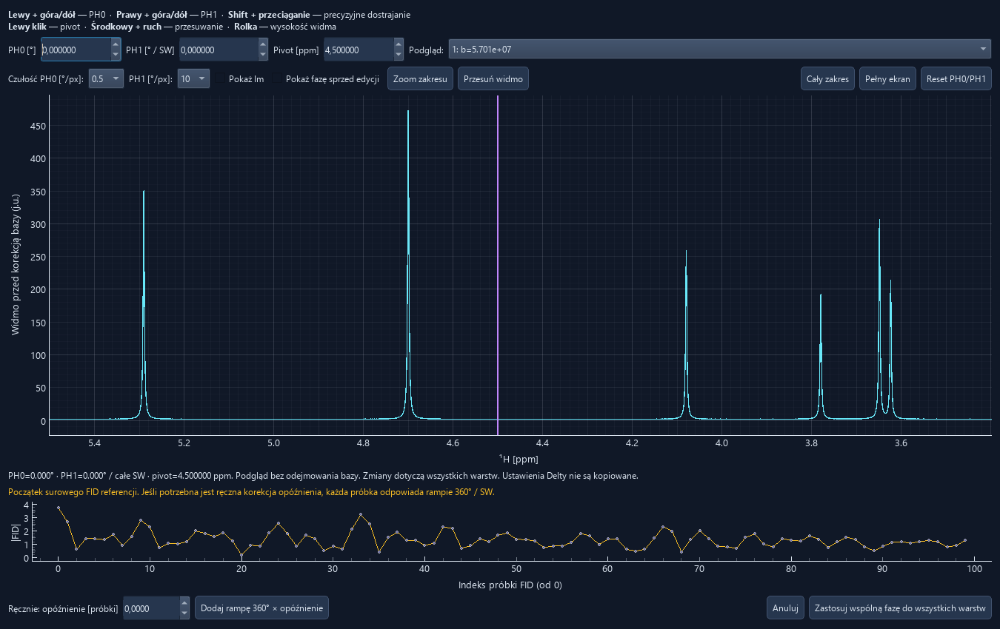
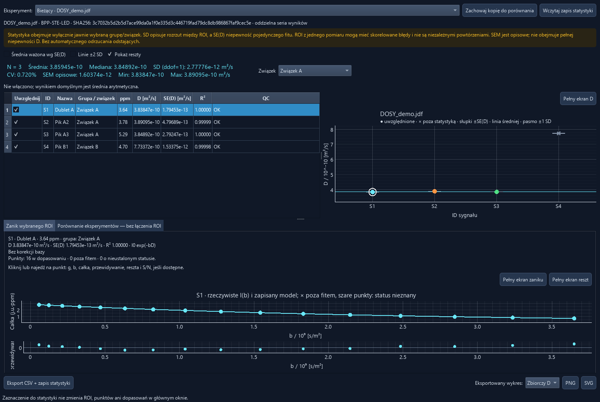
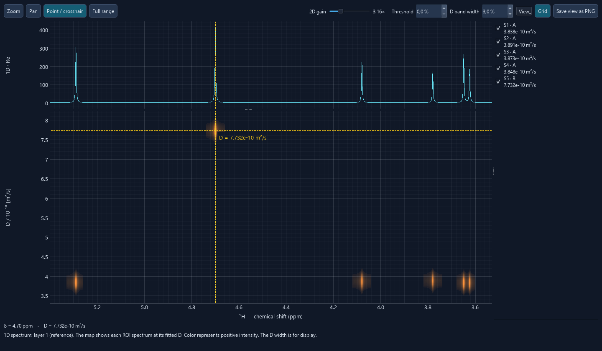

# DOSY Lab user guide

[Back to the README](README.md)

1. [Open data](#1-open-data)
2. [Navigation and processing](#2-navigation-and-processing)
3. [Phase correction](#3-phase-correction)
4. [Baseline correction](#4-baseline-correction)
5. [Integrals](#5-integrals)
6. [b values](#6-b-values)
7. [Fitting and quality control](#7-fitting-and-quality-control)
8. [D statistics](#8-d-statistics)
9. [Projects and exports](#9-projects-and-exports)
10. [Troubleshooting](#10-troubleshooting)
11. [2D DOSY map](#11-2d-dosy-map)
12. [Individual ILT](#12-individual-ilt)
13. [Global ILT](#13-global-ilt)
14. [Adaptive Local ILT](#14-adaptive-local-ilt)

## 1. Open data

1. Start the application as described in the [README](README.md#installation-on-windows).
2. Use **PL / ENG** next to **Info** to switch the interface. The application remembers your language preference.
3. Click **Open DOSY** and choose a raw JEOL `.jdf` file. The dialog starts in `data`. DOSY Lab processes the complex FIDs and displays the layer with the lowest verified **b**, or the lowest known encoding gradient if b is unavailable.
4. Open **Info** to inspect acquisition settings, the pulse program, processing, and the source of **b**.
5. Select a spectrum with **Layer**, or return to the reference using **Show reference**. Enter layer numbers such as `1,8,16` in **Overlay layers**. The first visible layer supplies the integral values displayed on the spectrum and in the main table. **Show Im** adds the imaginary spectrum.

Changing the visible layer preserves the ppm bounds of all ROIs. The decay fit uses the active points from the full gradient series. If the recorded timings or b sources conflict, the spectrum and integrals remain available. Inspect **b values** and supply a documented manual list before fitting.

## 2. Navigation and processing

| Control | Action |
| --- | --- |
| Scroll over the spectrum | Adjust the vertical intensity scale. |
| **Mouse integration [I]**, then drag with the left button | Mark the bounds of a new integral. |
| **Zoom [Z]**, then drag with the left button | Zoom into a ppm interval with live selection feedback. |
| Right-drag over the main spectrum | Zoom into a ppm interval while an integration tool is active. |
| **Pan [P]**, then drag | Move the spectrum horizontally or vertically. |
| Double-click or **Full range [F]** | Restore the full spectrum range. |
| **Full screen** | Open a large spectrum view. Press **Esc** to return. |
| **Save PNG** | Save the current spectrum view with a white background, black labels and a navy trace. |
| **View** | Adjust line color, line width and grid visibility. |

Press **I**, **Z**, **P** or **F** directly in the main window. While editing text, these keys type letters as usual.

**Processing** shows the parameters shared by the gradient series. The order is FID apodization, zero filling, FFT, common phase correction, optional baseline subtraction and signed real-part integration.

| Option | Meaning |
| --- | --- |
| **LB [Hz]** | Exponential apodization with $\exp(-\pi\cdot\mathrm{LB}\cdot t)$. |
| **Gaussian FWHM [Hz]** | Gaussian apodization with $\exp(-(\pi\cdot\mathrm{GB}\cdot t)^2/(4\ln 2))$. Both windows can be combined. Set either parameter to zero to disable its window. |
| **Zero filling** | Pad to 1×, 2×, 4× or 8× the acquired point count. This increases the density of the FFT grid. The acquisition determines physical resolution. |
| **PH0, PH1 and Pivot** | Shared phase settings. |
| **Target reference value / Reference from spectrum** | Assign a known ppm value to a point on the spectrum. See [Chemical shift reference](#chemical-shift-reference). |
| **Reference: ppm shift** | Shows the offset applied to all layers. You can also enter an offset manually. Check the integral bounds after a manual edit. |
| **Filter delay [samples]** | Set the separate phase ramp for digital filter delay. Zero disables the ramp. |
| **Crop to the JDF filter passband** | Use the passband recorded in the JDF. Point counts and acquisition time help distinguish a full FID from already clipped data. |
| **Reference layer** | Set the default phasing preview and the layer opened by **Show reference**. |
| **Save profile / Load profile** | Save or restore a JSON processing profile with a `.list` extension. Both dialogs start in `processing`. Review the phase, ppm reference and baseline regions when applying a profile to another sample. |

### Chemical shift reference

1. Zoom in on a signal with a known chemical shift so you can click its center precisely.
2. Open **Processing** and enter its known shift in **Target reference value**, for example `0.000000 ppm`.
3. Click **Reference from spectrum**, align the vertical guide with the center of the signal and left-click. To cancel before choosing a point, click **Reference from spectrum** again.
4. Check **Reference: ppm shift** for the calculated offset. For example, with an existing offset of `+0.03 ppm`, clicking at `0.08 ppm` and assigning `0.00 ppm` produces an offset of `−0.05 ppm`.

The correction shifts all layers, the phase pivot, integral bounds and baseline regions together. Save the project to keep the corrected axis and integral bounds.

## 3. Phase correction

1. Open **Phase correction**. The reference layer is shown first.
2. Click near a peak to set the **pivot**, or enter it in ppm. The correction at the pivot is PH0.
3. Drag up or down with the **left mouse button** to change **PH0** and with the **right mouse button** to change **PH1**. Hold **Shift** for fine adjustment. You can set the sensitivity of each gesture.
4. Use **Zoom range [Z]** and **Pan spectrum [P]** to inspect the signal. Press the same key again to resume phasing. **Full range [F]** or a left double-click resets the view. Scroll to adjust the height. Use **Show Im** and **Show previous phase** to inspect the effect.
5. Use **Preview** to check another gradient layer. **Apply shared phase to all layers** commits one correction to the full series. **Cancel** discards changes made in the dialog.

PH1 is specified in degrees across the entire acquired spectral width, in order of increasing ppm. The manual correction at a given point is $\mathrm{PH0}+\mathrm{PH1}\cdot(\mathrm{ppm}-\mathrm{pivot})/\mathrm{SW}_{\mathrm{ppm}}$. The displayed ppm axis usually decreases from left to right. Values from another program may use a different pivot, sign or axis convention.

When the JDF contains suitable decimation metadata, DOSY Lab estimates the filter delay and applies a separate shared ramp on opening a raw file. **Info** shows the applied delay. The phasing dialog can also add a manual ramp of 360° per sample of delay. Check the independent filter correction before adding that ramp.

## 4. Baseline correction

Choose **Select baseline** and draw several peak-free intervals, preferably on both sides of the signals to integrate. Blue bands mark the shared mask and yellow curves preview the fitted baselines.

The default polynomial order is **1**. **Separate polynomial for each layer** is enabled by default and fits an independent line or polynomial to each layer on the same ppm mask. Before applying the correction you may preview the reference-layer fit instead. **Apply baseline subtraction** always subtracts each layer’s own fitted baseline before integration. This also applies when reopening projects with baseline subtraction enabled.

Keep the blue baseline intervals clear of all ROIs. The fit extrapolates outside the outermost mask regions. Review the preview there before applying it. In **Processing**, use **Remove region** to remove one selected interval or **Undo correction** to disable subtraction while keeping the mask. **Clear baseline** above the spectrum removes the entire mask.

## 5. Integrals

An ROI is a ppm interval integrated in every layer. DOSY Lab integrates the signed real spectrum after common phasing and any applied baseline correction. Integrals have units of arbitrary intensity × ppm.

- With **Mouse integration** active, the shaded preview shows the ROI bounds as you drag.
- **Add integral manually** accepts two ppm bounds separated by a semicolon, for example `3.60; 3.68`. Decimal commas also work.
- **Edit integral** moves a region by its center or changes a bound by dragging its edge.
- **Split integral** divides an ROI where you release a dragged edge inside the region.
- **Delete integral** removes the selected ROI. Each integral has a stable ID. Double-click **Group / compound** to type a new group or reuse an existing one.

The ID is shown above the peak and the integral below. Edit **Integral** to set a relative reference, such as 1.00. The application proportionally rescales all displayed integrals and saves the factor in the project. Fits still use the original signed integrals.

Use **Export integrals** next to **Fit / refresh** to save the IDs, groups and ppm bounds to a `.ints` file in `integrals`. For a similar measurement, set its chemical shift reference first, then click **Import integrals**. Confirm replacement if the current measurement already has integrals. DOSY Lab keeps the saved IDs and bounds, resets integral scaling and fit point settings, and calculates new integrals and fits from the current measurement.

| Synthetic group | ppm ranges | Expected $`D\,[\mathrm{m^2/s}]`$ |
| --- | --- | --- |
| A | 3.60–3.68, 3.74–3.82, 5.26–5.33 | About $3.8\times 10^{-10}$ |
| B | 4.66–4.74 | About $8.0\times 10^{-10}$ |

## 6. b values

Open **b values** to review the gradient $g$ in $\mathrm{T/m}$ and diffusion weighting $b$ in $\mathrm{s/m^2}$ for every layer. Repeated b values remain separate observations.

1. Check whether b came from the JDF axis or a verified proton BPP-STE-LED or BPP-DSTE-LED model. DOSY Lab checks the embedded encoding block, timing and recorded `st_coef` when available. Supported waveform names for these models are `SQUARE`, `SINE`, `SQUARE_SINE`, `TRAPEZOID` and `S_RECTANGLE`.
2. For other sequences, use a list calculated independently for the actual experiment. **Import CSV** accepts a single column or a named `b`, `b_s_m2` or `b_s_per_m2` column.
3. Provide exactly one finite, non-negative value per layer in acquisition order. Keep repeated values. Click **Apply manual list** and record its source.

~~~csv
b_s_m2
5.70e7
2.99e8
5.41e8
~~~

The values above illustrate the file format. b values from nominal gradient amplitudes and timings are nominal. Instrument calibration remains an independent measurement.

## 7. Fitting and quality control

Each ROI is fitted to $I(b)=I_0\exp(-bD)$ using its signed integrals. A fit requires at least three distinct active b values. D and its standard error $\mathrm{SE}(D)$ are reported in $\mathrm{m^2/s}$. The main table scales both by $`10^{-10}\ \mathrm{m^2/s}`$. Inspect **QC**, $R^2$ and the residuals before interpreting a fit. Hover over **QC** for separate model and measurement diagnostics. **INFO** includes detected changes with no demonstrated effect on D or insufficient information. **WARNING** flags a credible risk to D. **INVALID** means the fit is unusable. An affected D may describe the whole ROI under the model. The checks preserve the fitted integrals and point selections.

- **Decays** shows measured points and fitted curves. **Show I / first integral** normalizes the display. Fitting uses the original integrals.
- **Residuals** shows measurement minus prediction for the selected ROI in a separate full-height tab.
- **Integrals / fit points** shows the layer values and their fit inclusion. Excluded points stay in the project and export. Use weighted fitting when valid $\sigma(I)$ values are available for the active layers.
- **Spectra in active ROI** compares line shapes across layers. Overlapping signals can produce an apparent D even when R² is high.
- Drag a rectangle on a plot to zoom and double-click to reset. The fullscreen button is in each plot tab.

When b is unavailable, the decay tab still displays integrals against the gradient or acquisition layer. A verified b list is required to estimate D.

## 8. D statistics

1. Assign groups in **Group / compound** in the main window. Open **D Statistics** and select a **Compound**.
2. The D plot and summary use checked signals from that group. Toggle **Include** to change the summary without changing the ROI or its fit.
3. Click a point or table row to open the cached decay and residuals. Hover a measured point to inspect g, b, integral, prediction, residual and S/N when available.
4. Use **Keep a copy for comparison** or **Load statistics snapshot** to compare separate experiments. Each keeps its own summary.
5. **Export CSV and snapshot** saves the numerical tables and JSON snapshot. **PNG** and **SVG** save the selected plot with a white background, black labels and navy data. Grid controls are available for the D plot and the decay and residual panel.

The summary includes the arithmetic mean, median, sample SD, CV, descriptive SEM, minimum, maximum and N where defined. The plot shows $\pm\mathrm{SE}(D)$ bars, the mean and a $`\pm1\,\mathrm{SD}`$ band. You can add $`\pm2\,\mathrm{SD}`$ lines. Sample SD, CV and descriptive SEM require at least two signals.

- **SE(D)** describes uncertainty in one fit under its model.
- **SD** describes spread across selected signals. **SEM** is descriptive $\mathrm{SD}/\sqrt{N}$. ROIs from one experiment can share errors, including gradient calibration errors.
- **Weighted mean by SE(D)** uses $1/\mathrm{SE}^2$ weights. Enable it only when all included SE values are finite, positive and comparable.

## 9. Projects and exports

**Save project** and **Load project** start in `projects`. The `.proj` file stores JSON with processing, phase, manual b, ROI bounds, groups, fit masks, integral scaling and the source JDF path and SHA-256. If the JDF moves, DOSY Lab searches for the same filename next to the project and under `data`, `work` and `examples`, then verifies the checksum.

When saving a project, processing profile or individual image, DOSY Lab suggests the source JDF filename with the appropriate output extension. In the statistics window the suggestion follows the selected experiment. You can edit the name in the save dialog.

Older DOSY Lab project and processing JSON files can be opened after changing their extensions to `.proj` or `.list`, respectively. Statistics snapshots retain the `.json` extension.

**Export D statistics** in the main window saves an analysis bundle.

| File | Contents |
| --- | --- |
| `roi_results.csv` | ROI bounds, groups, D, SE, R² and QC |
| `integrals_and_fits.csv` | Layer integrals, g, b, predictions, residuals and fit inclusion |
| `compound_statistics.csv` | Summaries by explicitly assigned compound group |
| `DOSY_results.xlsx` | ROI, point, statistics, processing and experiment sheets |
| `experiment.json`, `processing.json`, `fit_results.json` | Metadata, options and fit details |
| `project.proj`, `statistics_snapshot.json` | Reopenable project and statistics snapshot |
| `complex_data.npz` | FIDs, ppm, complex spectra, baseline, gradients and b |
| `embedded_sequence.txt` | Pulse program text if embedded in the JDF |
| `Raport.md` and PNG/SVG files | Analysis summary and figures |

An export bundle can contain complete measurement data and the embedded pulse program. Select the files appropriate for the recipient before sharing.

## 10. Troubleshooting

| Symptom | What to check |
| --- | --- |
| No D values | Verify the source of b and the number of distinct active b values. |
| Negative or unstable integrals | Check absorption phase, baseline and possible peak overlap. Compare the same ROI across layers. |
| Ripples before baseline correction | Inspect the filter delay and passband in **Info** and **Processing**. Check shared PH0 and PH1 against several peaks. |
| Good R² but inconsistent D across signals | Compare residuals, ROI spectra, b calibration, integration bounds and compound assignments. |
| Statistics show N = 0 | Check the selected **Compound**, the **Include** column and QC. |
| A project cannot find its JDF | Place the original JDF next to the project or in `data`. DOSY Lab verifies the source checksum. |
| Launcher closes or dependencies are missing | Try the [manual installation](README.md#installation-on-windows) and run `bin/app.py` with the same environment. |

## 11. 2D DOSY map

1. Define integrals and complete their fits. Click **2D DOSY map** next to **Clear baseline**.
2. Use **Groups / compounds** to hide an entire group or **Signals** to hide individual ROIs. Turning a group back on preserves individual selections. A displayed ROI must have a successful fit with finite, positive D. The checkboxes affect the map only.
3. Use **Zoom [Z]** to drag a rectangle, **Pan [P]** to move, or **Full range [F]** to reset. The ppm zoom is linked to the 1D spectrum above.
4. Use **Point / crosshair** to read ppm and D. The vertical guide extends into the proton spectrum. Enable **D projection** to sum the positive map intensity across ppm for each D and show the horizontal guide on the left. The sum uses the displayed ROIs before the visual floor and gain are applied. Press **Delete** to clear the guides and label. PNG export includes the projection and guides when visible.
5. Scroll over the 1D spectrum to adjust its height, or over **D projection** to adjust its horizontal intensity scale while retaining its D range. Scroll over the 2D map to change the **Threshold** relative to the strongest positive signal. Increase **2D gain** to brighten weak signals above the threshold.
6. Use **View** for separate spectrum and map colors and **Grid** to toggle the grid. **Save view as PNG** exports the current zoom, intensity, grid and guides in a light color scheme.

The map places each ROI’s positive real reference spectrum at its fitted D. Orange is the default signal color. Shared points of overlapping selected ROIs are omitted until the overlap is resolved. **D band width** controls the vertical display broadening as a percentage of the largest visible D. Each ROI contributes one fitted coefficient, so mixed signals within an ROI are represented by an apparent D.

The description above applies to **Original DOSY map**. Select another **Map mode** to explore different assumptions. **D-aligned DOSY · display only** moves compatible ROI profiles onto representative group positions. **Global fit DOSY** refits each compatible group using one shared D and independent ROI amplitudes. **Global ILT DOSY · ROI profiles** becomes available after a converged Global ILT for the current results. **Adaptive Local ILT** builds its own groups from the current fits. Compare each result with the original map. Use **Full screen** for an enlarged view and **Esc** to return. See the [map mode guide](DOSY-ALIGNMENT.md) for group membership, visibility, thresholds and fallback behavior.

## 12. Individual ILT

1. Complete the conventional fit and check its signed intensities, baseline and excluded layers. Each ROI needs six distinct included b values.
2. Click **Analyze ILT** in the ROI's **ILT** column. The analysis uses a snapshot of the current fit data. Reopen the window after changes to the ROI or processing.
3. Start with the default grid and penalty. Use the $\lambda$ slider or field, **D min / D max**, **Grid points**, **D grid** and **Penalty** to test sensitivity. **Logarithmic D axis** only changes the view. Use **Restore defaults** to return to the starting settings.
4. Compare experimental attenuation, monoexponential and ILT reconstructions, then inspect residuals and solver diagnostics. A smaller residual RMS can reflect model flexibility. Check grid-edge maxima and whether candidate positions persist across reasonable settings.
5. Open **Info** for controls and definitions. Save an individual plot or a stacked PNG. Close with the title-bar **×** or **Esc**. See the [individual ILT guide](ILT.md) for density units and defaults.

## 13. Global ILT

1. Ctrl-click or Shift-click two or more eligible rows in the fit table, then click **Global ILT** next to **Fit / refresh**.
2. Start with the default D grid and regularization. Adjust $\lambda$ to change the ridge penalty and $\mu$ to change the preference for shared D positions. Enter $\mu=0$ to remove the coupling. Choose **Compare independent ILT** to overlay the separate inversion for the active ROI.
3. Inspect the joint and individual distributions. Use the ROI selector for the attenuation and residuals. Toggle the common ROI amplitude scale or use the visibility menu to compare selected profiles.
4. Review **Component contributions** and **Results** together. Component shares sum fitted cell masses across intervals. Treat them as fitted signal fractions under the chosen model.
5. Use **Info** for the guide, and export individual plots or the combined PNG. For the 2D map, finish a converged solve and then select **Global ILT DOSY · ROI profiles**. Reopen Global ILT after changing the source data or selection. See the [Global ILT guide](GLOBAL-ILT.md) for weighting and convergence details.

## 14. Adaptive Local ILT

1. Fit the regions conventionally and open **2D DOSY map**. Select **Adaptive Local ILT** from **Map mode**.
2. Inspect the default result before tuning **D tolerance** (5%), **Amplitude balance** (10×) and **Local λ** ($10^{-6}$). The first sets candidate group membership, the second controls when weaker signals may be downweighted, and the third controls the local ridge penalty.
3. Open **Group diagnostics** to compare ROI counts, the original D range, amplitude ratios, recovered D, residuals and unresolved profiles. Use the group checkbox for visibility and the member checkbox to exclude an ROI from regrouping. Edits schedule a new solve.
4. Compare with **Original DOSY map** and export the view if needed. Unresolved regions retain their original representation. See [adaptive grouping and map reconstruction](DOSY-ALIGNMENT.md#adaptive-local-ilt) and the [scientific methods](SCIENTIFIC-METHODS.md) before assigning physical meaning to separate bands.
