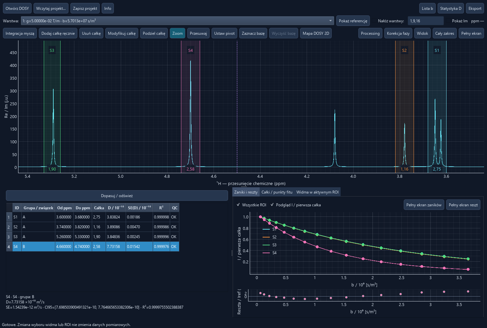

# DOSY Lab 1.0

DOSY Lab is a Windows desktop application for classical 1D diffusion NMR acquired on JEOL instruments. It opens raw JDF gradient series, processes the complex FIDs with a shared phase, and estimates the diffusion coefficient **D** from the decay of selected integrals.

*Synthetic example. The main window has separate tabs for decays and residuals.*

## Features

- Inspect the reference spectrum at the lowest **b**, switch gradient layers, or overlay several spectra.
- Adjust apodization, zero filling, ppm referencing, digital filter delay, shared phase and per-layer baseline subtraction.
- Draw, edit, split and rescale integrals. Fit a monoexponential decay and inspect individual measured points, fit residuals and quality indicators.
- Compare diffusion coefficients within a named compound group and compare summaries from separate experiments.
- Build a 2D ppm × D map from selected integrals and the reference spectrum.
- Save projects and processing profiles, export tables, and save figures with a light background.
- Switch the interface between Polish and English using **PL / ENG** next to **Info**.

## Installation on Windows

Install Python 3.11 or newer. Download and extract the repository through **Code → Download ZIP**, or clone it with Git.

~~~powershell
git clone https://github.com/Prospero1988/DOSY_lab.git
cd DOSY_lab
~~~

Double-click **DOSY Lab.cmd**, or run it in PowerShell. On first launch it creates `.venv` and installs the required packages. After installation the application runs locally.

~~~powershell
& '.\DOSY Lab.cmd'
~~~

Manual installation in PowerShell

~~~powershell
py -3 -m venv .venv
.\.venv\Scripts\python.exe -m pip install -r bin\requirements.txt
.\.venv\Scripts\python.exe bin\app.py
~~~

If Windows provides `python` instead of `py`, use `python -m venv .venv` for the first command.

## Try a synthetic experiment

~~~powershell
.\.venv\Scripts\python.exe bin\generate_demo.py
& '.\DOSY Lab.cmd' '.\examples\DOSY_demo.jdf'
~~~

The generator creates 16 layers and preserves existing files. Pass a different output path to generate another copy. Use **Add integral manually** and enter `3.60; 3.68`, then repeat with `4.66; 4.74`. The expected **D** values are about **3.8 × 10⁻¹⁰ m²/s** and **8.0 × 10⁻¹⁰ m²/s**. The main table displays these as approximately **3.8** and **8.0** in its scaled D column.

## User guide

The [user guide](INSTRUKCJA.md) walks through opening data, processing, phase and baseline correction, integration, fitting, statistics and exports.

- [Keyboard shortcuts](INSTRUKCJA.md#2-navigation-and-processing)
- [Chemical shift reference](INSTRUKCJA.md#chemical-shift-reference)
- [Interactive phase correction](INSTRUKCJA.md#3-phase-correction)
- [Where b values come from](INSTRUKCJA.md#6-b-values)
- [D statistics and fit diagnostics](INSTRUKCJA.md#8-d-statistics)
- [Experimental inverse Laplace analysis](ILT.md)
- [Experimental Global ILT for selected ROIs](GLOBAL-ILT.md)
- [Project files and exports](INSTRUKCJA.md#9-projects-and-exports)
- [2D DOSY map from integrals](INSTRUKCJA.md#11-2d-dosy-map)

## Input and scope

- The reader accepts raw JEOL JDF data with complex direct FIDs and gradient layers. Supported 2D storage layouts are `small_two_d` and `two_d`, with 32- or 64-bit values in either byte order. A supported single FID can be viewed as a 1D spectrum.
- Automatic **b** values come from an explicit JDF b axis or verified proton BPP-STE-LED and BPP-DSTE-LED encoding blocks, including the supported presaturation variant. The reader checks the timing and the recorded `st_coef` when available. Other sequences can use an independently calculated manual b list.
- The application is designed for classical 1D DOSY. Processed JDFs and 3D COSY-DOSY, COSY-iDOSY and HMQC-DOSY are outside its scope.
- Quantitative results depend on gradient calibration, the b model, integral quality and the suitability of the decay model.

## Workspace and tests

| Location | Purpose |
| --- | --- |
| `bin` | Application, dependencies and tests |
| `docs` | User guide, screenshots and license |
| `examples` | Reference sucrose and strychnine acquisitions |
| `data` | Default directory for opening local JDF data |
| `projects` | Local `.proj` files |
| `processing` | Local `.list` profiles |
| `work` | Local working data |

Git ignores `data`, `work`, `projects` and `processing`.

~~~powershell
.\.venv\Scripts\python.exe -m unittest discover -s bin -v
~~~

Tests cover the synthetic example, reference acquisitions when present, numerical processing and the Qt interface in offscreen mode.

## License

DOSY Lab is distributed under the [MIT license](LICENSE).
